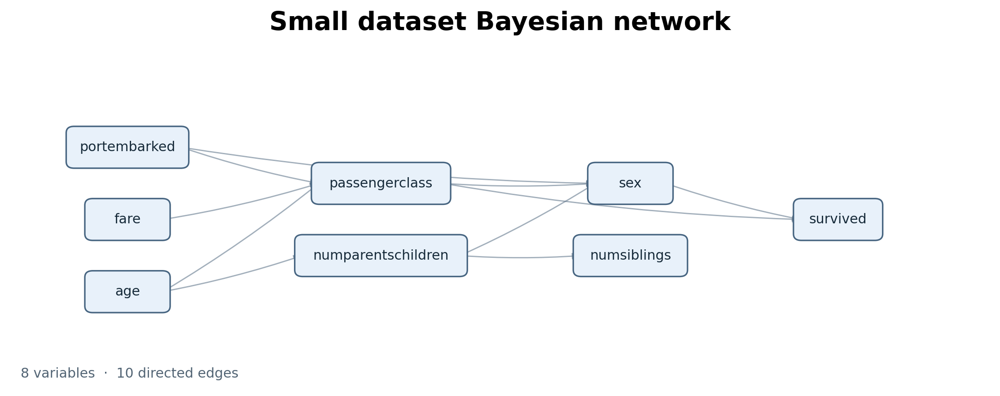
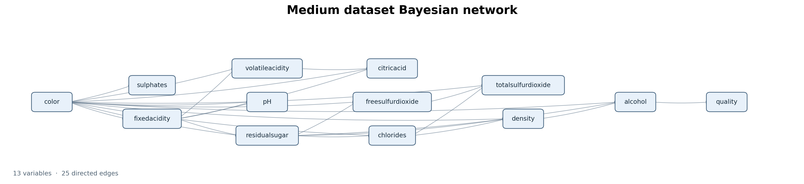
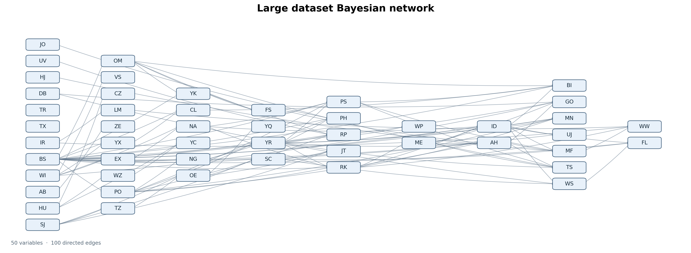

# Bayesian Structure Learning (Project 1)
### Julia Jiang 
### Fall 2026 
### CS238 


# Algorithm 
I used the K2 algorithm, which greedily builds the network by iterating through the nodes to find parents that maximally increase the Bayesian score. I set a limit of 5 parents for any node to reduce computation. 

I also assume that the prior is the uniform Dirichlet distribution, as described in the textbook. 

# Runtime 
The runtime below measures the K2 search (`fit`) in seconds. It excludes reading the CSV and writing the graph file. Higher Bayesian scores are better. All three learned graphs scored higher than the empty-edge baseline.

| Dataset | K2 Bayesian score | Empty-edge baseline score | Runtime (seconds) | Beats baseline? |
|:--|--:|--:|--:|:--:|
| Small | -3835.6794252128 | -4166.2258587849 | 0.00036 | Yes |
| Medium | -97918.4419490843 | -117668.9985866486 | 0.00756 | Yes |
| Large | -478642.7253532500 | -524395.4007210814 | 0.25191 | Yes |

# Graphs  
### Small dataset


### Medium dataset


### Large dataset



# Code

The complete Julia implementation is included below, organized by source file.


### `project1.jl`

```julia
"""
project1.jl: script to compute a graph based on the data

written by: julia jiang for CS238
"""

using Graphs
using Printf
using CSV
using DataFrames
using SpecialFunctions

include("score.jl")
include("parse_data.jl")
include("k2.jl")

function write_gph(dag::DiGraph, idx2names, filename)
    """
    input: dict of index to names 
    output: filename in gph form 
    """
    open(filename, "w") do io
        for edge in edges(dag)
            @printf(io, "%s,%s\n", idx2names[src(edge)], idx2names[dst(edge)])
        end
    end
end

function compute(infile, outfile)
    """
    computes the graph using k2 algo and returns the graph and score 
    """
    vars, D, idx2names = load_data(infile)
    n = length(vars)
    method = K2Search(collect(1:n))

    seconds = @elapsed G = fit(method, vars, D) # runtime 

    write_gph(G, idx2names, outfile) # made the gph file 
    score = bayesian_score(vars, G, D) # score 

    G_baseline = SimpleDiGraph(n) # baseline is empty edge graph 
    baseline_score = bayesian_score(vars, G_baseline, D)
    @printf("Empty-edge baseline score for %s: %.10f\n", infile, baseline_score)
    if score > baseline_score
        println("huzzah")
    else
        println("try again u didn't beat the baseline")
    end
    
    @printf("Bayesian score for %s: %.10f\n", infile, score)
    @printf("K2 runtime: %.5f seconds\n", seconds)
    return G, score
end

if abspath(PROGRAM_FILE) == @__FILE__
    for name in ("small", "medium", "large")
        infile = joinpath(@__DIR__, "data", "$name.csv")
        outfile = joinpath(@__DIR__, "$name.gph")
        compute(infile, outfile)
    end
end
```


### `parse_data.jl`

```julia
"""
load CSVs and .gph files for structure learning 
"""

function load_data(path)
    """
    takes in the csv file 
    returns:
        - vector of the variables 
        - data matrix (variables x observations)
        - map from variable index to its name 
    """
    df = CSV.read(path, DataFrame)
    colnames = names(df)
    D = permutedims(Matrix{Int}(df))  # variables × observations : turn into ints then transpose 
    num_vars = size(D, 1)  
    vars = [Variable(Symbol(colnames[i]), maximum(D[i, :])) for i in 1:num_vars]
    idx2names = Dict(i => String(colnames[i]) for i in 1:num_vars) # idx2names[1] = "age"
    return vars, D, idx2names
end

function graph_from_gph(path, idx2names)
    """
    takes in .gph and turns it into graph object 
    """
    name2idx = Dict(name => i for (i, name) in idx2names)
    G = SimpleDiGraph(length(idx2names))
    for line in eachline(path) # add the nodes from the .gph file 
        s = strip(line) 
        isempty(s) && continue 
        a, b = split(s, ',') 
        add_edge!(G, name2idx[strip(String(a))], name2idx[strip(String(b))])
    end
    return G 
end
```


### `score.jl`

```julia
"""
functions to calculate bayesian score from textbook 
"""

# --------- getting the right data structures ------ #

struct Variable
    name::Symbol # variable name 
    r::Int  # number of possible values it can take on 
end

function n_parent_instantiations(vars, G, i)
    """
        returns the number of parent combinations, i.e.
        how many rows should the count table for node i have 

        args: 
            - vars: variables
            - G: the graph we are tryna calculate the score for 
            - i: the node we are on rn 
    """
    parents = inneighbors(G, i)
    return isempty(parents) ? 1 : prod(vars[j].r for j in parents)
end

function parental_index(vars, G, o, i)
    """
    converts the parents' values for one observation into a row number 
    args: 
        - vars: variables 
        - G: the graph we are tryna calculate the score for 
        - o: observation vector
        - i: the node we are on rn 
    return: the row number 
    """
    parents = inneighbors(G, i)
    j = 1
    for (position, node) in enumerate(parents)
        combs = 1 # how many combinations come b4 this parent's value 
        for p in 1:(p - 1) # loop over positions b4 current parent 
            combs *= vars[parents[p]].r
        end
        j += (o[node] - 1) * combs
    end
    return j 
end

function count_matrix_i(vars, G, D::AbstractMatrix{Int}, i::Int)
    """
    makes count matrix for variable i 
    """
    num_rows = n_parent_instantiations(vars, G, i) 
    num_cols = vars[i].r
    Mi = zeros(num_rows, num_cols)
    for o in eachcol(D) # loop thru observation cols 
        Mi[parental_index(vars, G, o, i), o[i]] += 1.0
    end
    return Mi
end

function count_matrices(vars, G, D::AbstractMatrix{Int})
    """
    count data for every variable 
    returns a list of count matrices (1 for each var)
    """
    n = length(vars)
    return [count_matrix_i(vars, G, D, i) for i in 1:n]
end

function prior_i(vars, G, i)
    """
    the uniform dirichlet pseudocounts for the ith var (matrix of all 1s :P)
    """
    return ones(n_parent_instantiations(vars, G, i), vars[i].r)
end

function prior(vars, G)
    """
    all da uniform dirichlet pseudocounts in a list 
    """
    n = length(vars)
    return [prior_i(vars, G, i) for i in 1:n]
end

# --------- score calculation ------- # 
function bayesian_score_component(M, alpha)
    p = sum(loggamma.(alpha + M))
    p -= sum(loggamma.(alpha))
    p += sum(loggamma.(sum(alpha, dims=2)))
    p -= sum(loggamma.(sum(alpha, dims=2) + sum(M, dims=2)))
    return p
end

function bayesian_score_i(vars, G, D, i)
    return bayesian_score_component(statistics_i(vars, G, D, i), prior_i(vars, G, i))
end

function bayesian_score(vars, G, D)
    n = length(vars)
    return sum(bayesian_score_i(vars, G, D, i) for i in 1:n)
end
```


### `k2.jl`

```julia
"""
textbook implementation of k2 search
"""

struct K2Search
    ordering::Vector{Int}
    max_parents::Int
end

K2Search(ordering::Vector{Int}) = K2Search(ordering, 5)

function fit(method::K2Search, vars, D)
    n = length(vars)
    G = SimpleDiGraph(n)

    for (k, i) in enumerate(method.ordering[2:end])
        # i is the variable we are choosing parents for
        # k is how many variables come before it in the ordering
        y = bayesian_score_i(vars, G, D, i)

        while length(inneighbors(G, i)) < method.max_parents
            y_best, j_best = -Inf, 0

            for j in method.ordering[1:k]
                if !has_edge(G, j, i)
                    add_edge!(G, j, i)
                    y′ = bayesian_score_i(vars, G, D, i)

                    if y′ > y_best
                        y_best, j_best = y′, j
                    end

                    rem_edge!(G, j, i)
                end
            end

            if y_best > y
                y = y_best
                add_edge!(G, j_best, i)
            else
                break
            end
        end
    end

    return G
end
```


# AI Disclosure 
I used ChatGPT to clarify some questions I had about the algorithms in chapter 5 of the textbook on page 103 as well as exercise 4.4 which helped me understand how to construct count matrices. 
